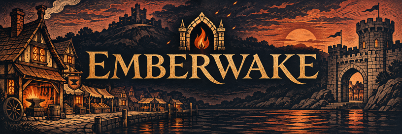

# Emberwake

Emberwake is an independent medieval fantasy roleplay server forked from the archived CrystallPunk 14 version of CrystallEdge. Players can study magic, brew potions, and join guilds on Comoss Island. The game runs on RobustToolbox, the engine developed by the Space Wizards Federation for Space Station 14.

[Original CrystallPunk 14 release](https://github.com/crystallpunk-14/crystall-punk-14/tree/5b6108377e40235c768be3ac6ffadb37a085f441) · [RobustToolbox](https://github.com/space-wizards/RobustToolbox) · [Space Station 14](https://github.com/space-wizards/space-station-14)

## Building

1. Clone this repo.
2. Run `RUN_THIS.py` to init submodules and download the engine.
3. Compile the solution.

[More detailed instructions on building the project.](https://docs.spacestation14.com/en/general-development/setup.html)

## License

All code for the content repository is licensed under the [MIT license](https://github.com/crystallpunk-14/crystall-punk-14/blob/master/LICENSE.TXT).  

Most assets are licensed under [CC-BY-SA 3.0](https://creativecommons.org/licenses/by-sa/3.0/) unless stated otherwise. Assets have their license and copyright specified in the metadata file. For example, see the [metadata for a crowbar](https://github.com/crystallpunk-14/crystall-punk-14/blob/master/Resources/Textures/Objects/Tools/crowbar.rsi/meta.json).  

> [!NOTE]
> Some assets are licensed under the non-commercial [CC-BY-NC-SA 3.0](https://creativecommons.org/licenses/by-nc-sa/3.0/) or similar non-commercial licenses and will need to be removed if you wish to use this project commercially.
